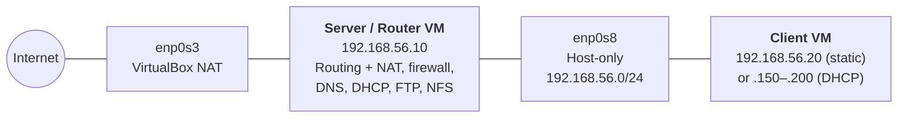

# Linux Network Services: Router, DNS, DHCP, FTP and NFS

A small private network built on two Ubuntu Server VMs in VirtualBox. One VM is set up as a
**router and server** that runs five network services. The other is a **client** that gets
everything it needs from it automatically.

| Service | Software | What it does |
|---|---|---|
| Routing and NAT | Netplan, iptables | Forwards client traffic and shares the internet connection |
| Firewall | iptables (default deny) | Only lets in the traffic each service needs |
| DNS | BIND9 | Resolves local names (forward and reverse) and forwards everything else |
| DHCP | ISC DHCP | Hands out IP addresses, the gateway, DNS and the domain name |
| FTP | vsftpd | Authenticated file transfer, users locked to their home folders |
| NFS | nfs-kernel-server | Shared folders (read-write and read-only), mounted on the client at boot |

All five run at the same time and work together: the client gets an address from DHCP, finds
names through DNS, reaches the internet through NAT, mounts shared folders over NFS and moves
files over FTP.

---

## Network layout



| Setting | Value |
|---|---|
| Server IP | `192.168.56.10` |
| Client IP (static, for testing) | `192.168.56.20` |
| DHCP range | `192.168.56.150` – `192.168.56.200` |
| Subnet | `192.168.56.0/24` |
| Domain | `homelab.lan` |
| Router, DNS and gateway | `192.168.56.10` |
| External interface (internet) | `enp0s3` (VirtualBox NAT) |
| Internal interface (private network) | `enp0s8` (VirtualBox Host-only) |

You can use your own values. Just change them the same way in every config file.

---

## Repository contents

| File | Goes to (on the server) | Section |
|---|---|---|
| [`config/sysctl.conf`](config/sysctl.conf) | `/etc/sysctl.conf` | [Routing and NAT](#1-routing-and-nat) |
| [`config/firewall.sh`](config/firewall.sh) | `/root/firewall.sh` | [Routing and NAT](#1-routing-and-nat) |
| [`config/named.conf.options`](config/named.conf.options) | `/etc/bind/named.conf.options` | [DNS](#2-dns-bind9) |
| [`config/named.conf.local`](config/named.conf.local) | `/etc/bind/named.conf.local` | [DNS](#2-dns-bind9) |
| [`config/db.homelab.lan`](config/db.homelab.lan) | `/var/cache/bind/db.homelab.lan` | [DNS](#2-dns-bind9) |
| [`config/db.192.168.56`](config/db.192.168.56) | `/var/cache/bind/db.192.168.56` | [DNS](#2-dns-bind9) |
| [`config/dhcpd.conf`](config/dhcpd.conf) | `/etc/dhcp/dhcpd.conf` | [DHCP](#3-dhcp-isc-dhcp-server) |
| [`config/vsftpd.conf`](config/vsftpd.conf) | `/etc/vsftpd.conf` | [FTP](#4-ftp-vsftpd) |
| [`config/exports`](config/exports) | `/etc/exports` | [NFS](#5-nfs) |
| [`config/nfs.conf`](config/nfs.conf) | `/etc/nfs.conf` | [NFS](#5-nfs) |

---

## Contents

1. [Routing and NAT](#1-routing-and-nat)
2. [DNS (BIND9)](#2-dns-bind9)
3. [DHCP (ISC DHCP Server)](#3-dhcp-isc-dhcp-server)
4. [FTP (vsftpd)](#4-ftp-vsftpd)
5. [NFS](#5-nfs)
6. [How it all fits together](#how-it-all-fits-together)
7. [Lab vs production](#lab-vs-production)

Each section builds on the one before it, and ends with a checklist and a troubleshooting guide.

---

## 1. Routing and NAT

Turns the server VM into a router: it forwards packets, shares its internet connection (NAT)
and controls traffic with a firewall.

### 1.1 Add a second network interface

In VirtualBox:

1. Power off the VM.
2. Go to **Settings → Network → Adapter 2**.
3. Enable it as a **Host-only Adapter**, with **Cable Connected** ticked.
4. Boot the VM.

Check the new interface exists:

```bash
# Shows all network interfaces. enp0s8 should be listed.
ip link show
```

Give it a static IP with Netplan:

```bash
sudo nano /etc/netplan/second-interface.yaml
```

```yaml
# Static IP for the internal (Host-only) interface.
network:
  version: 2
  renderer: networkd
  ethernets:
    enp0s8:
      addresses:
        - 192.168.56.10/24
```

```bash
# Apply and check.
sudo netplan apply
ip addr show enp0s8
```

### 1.2 Enable IP forwarding

```bash
# Turn forwarding on now (until reboot).
sudo sysctl -w net.ipv4.ip_forward=1

# Make it permanent: add or uncomment this line in /etc/sysctl.conf
sudo nano /etc/sysctl.conf
```

```
net.ipv4.ip_forward=1
```

### 1.3 Set up NAT

```bash
# Hide internal IPs behind the router's external IP (internet sharing).
sudo iptables -t nat -A POSTROUTING -o enp0s3 -j MASQUERADE

# Let traffic go from the internal network out to the internet.
sudo iptables -A FORWARD -i enp0s8 -o enp0s3 -j ACCEPT

# Let the replies come back in.
sudo iptables -A FORWARD -i enp0s3 -o enp0s8 -m state --state ESTABLISHED,RELATED -j ACCEPT

# Check the rules.
sudo iptables -t nat -L -n -v
sudo iptables -L FORWARD -n -v
```

### 1.4 Firewall script (default deny)

Keeping the rules in one script means they're applied the same way every time.
See [`config/firewall.sh`](config/firewall.sh).

```bash
sudo nano /root/firewall.sh
```

```bash
#!/bin/bash
# Firewall configuration for the router

# Start clean.
iptables -F
iptables -t nat -F
iptables -X

# Default: drop incoming and forwarded traffic, allow outgoing.
iptables -P INPUT DROP
iptables -P FORWARD DROP
iptables -P OUTPUT ACCEPT

# Allow the loopback interface.
iptables -A INPUT -i lo -j ACCEPT

# Allow replies to connections we started (incoming and forwarded).
iptables -A INPUT -m state --state ESTABLISHED,RELATED -j ACCEPT
iptables -A FORWARD -m state --state ESTABLISHED,RELATED -j ACCEPT

# SSH, only from the internal network.
iptables -A INPUT -p tcp --dport 22 -i enp0s8 -j ACCEPT

# DNS (UDP and TCP).
iptables -A INPUT -p udp --dport 53 -j ACCEPT
iptables -A INPUT -p tcp --dport 53 -j ACCEPT

# DHCP.
iptables -A INPUT -p udp --dport 67:68 -j ACCEPT

# Ping, only from the internal network.
iptables -A INPUT -p icmp --icmp-type echo-request -i enp0s8 -j ACCEPT

# Internal clients can reach the internet.
iptables -A FORWARD -i enp0s8 -o enp0s3 -j ACCEPT

# NAT on the external interface.
iptables -t nat -A POSTROUTING -o enp0s3 -j MASQUERADE

echo "Firewall configured successfully"
```

```bash
sudo chmod +x /root/firewall.sh
sudo /root/firewall.sh

# Check the rules, and that the router itself can reach the internet.
sudo iptables -L -n -v
ping -c 2 8.8.8.8
```

### 1.5 Make it survive reboots

```bash
# Save the rules so they load at boot.
sudo apt install iptables-persistent netfilter-persistent
sudo netfilter-persistent save
```

Run the firewall script at boot with a systemd service:

```bash
sudo nano /etc/systemd/system/firewall.service
```

```ini
[Unit]
Description=Configure Firewall
After=network.target

[Service]
Type=oneshot
ExecStart=/root/firewall.sh
RemainAfterExit=yes

[Install]
WantedBy=multi-user.target
```

```bash
sudo systemctl enable firewall.service
sudo systemctl start firewall.service
```

### 1.6 Create and test the client VM

1. Shut down the router VM.
2. In VirtualBox: right-click → **Clone** → **Full Clone**.
3. On the clone, **disable Adapter 1** and keep Adapter 2 (Host-only).
4. Start the client VM.

Give the client a static IP for testing (DHCP comes later):

```bash
sudo nano /etc/netplan/client.yaml
```

```yaml
network:
  version: 2
  renderer: networkd
  ethernets:
    enp0s8:
      # Static IP, so the client is easy to find while testing.
      addresses:
        - 192.168.56.20/24
      # Send all traffic through the router.
      routes:
        - to: default
          via: 192.168.56.10
      # Public DNS for now (the local DNS server comes in section 2).
      nameservers:
        addresses: [8.8.8.8, 8.8.4.4]
```

```bash
sudo netplan apply

# Can the client reach the router?
ping -c 2 192.168.56.10

# Can the client reach the internet through the router?
ping -c 2 8.8.8.8
```

If both pings work, routing and NAT are working.

### ✅ Checklist

| Test | Expected result |
|---|---|
| `sysctl net.ipv4.ip_forward` | `1` |
| `sudo iptables -t nat -L -n -v` | MASQUERADE rule shown |
| Router: `ping 8.8.8.8` | Works |
| Client: `ping 8.8.8.8` | Works |
| `sudo /root/firewall.sh` | Runs with no errors |
| `systemctl status firewall.service` | `active (exited)` |

<details>
<summary><b>🔧 Troubleshooting: Routing and NAT</b></summary>

**Interface down or missing IP**

```bash
ip a                        # enp0s8 should have 192.168.56.10/24
sudo ip link set enp0s8 up  # if it shows DOWN
sudo netplan apply
```

**IP forwarding is off** (`sysctl net.ipv4.ip_forward` returns `0`)

```bash
sudo sysctl -w net.ipv4.ip_forward=1
# Then make sure net.ipv4.ip_forward=1 is in /etc/sysctl.conf
```

**NAT rule missing**

```bash
sudo iptables -t nat -L -n -v
sudo iptables -t nat -A POSTROUTING -o enp0s3 -j MASQUERADE
```

**Forwarded traffic is dropped**

```bash
sudo iptables -L FORWARD -n -v
sudo iptables -A FORWARD -i enp0s8 -o enp0s3 -j ACCEPT
sudo iptables -A FORWARD -i enp0s3 -o enp0s8 -m state --state ESTABLISHED,RELATED -j ACCEPT
```

**Router can't reach the internet**

- Check Adapter 1 is set to NAT in VirtualBox.
- Check the host's own internet connection.
- Restart networking: `sudo systemctl restart systemd-networkd`

**Client can't reach the router** (`ping 192.168.56.10` fails)

- Check the client's IP settings.
- Make sure the client's `enp0s8` is UP.

**Router has internet but the client doesn't**

- NAT rule missing, forwarding rules missing, or the firewall script isn't running.

**Firewall service not active**

```bash
sudo systemctl status firewall.service   # should be active (exited)
sudo systemctl start firewall.service
sudo systemctl enable firewall.service
```

**Rules gone after a reboot**

```bash
sudo netfilter-persistent save
sudo netfilter-persistent reload
```

**Quick reset (if everything breaks)**

```bash
sudo iptables -F
sudo iptables -t nat -F
sudo iptables -X
sudo /root/firewall.sh   # re-run the known-good script
```

</details>

---

## 2. DNS (BIND9)

A DNS server that resolves local names (like `server.homelab.lan`) and forwards everything else
(like `google.com`) to public DNS. It has a forward zone and a reverse zone.

### 2.1 Install BIND9

```bash
sudo apt update
sudo apt install bind9 bind9-utils bind9-doc -y
sudo systemctl enable named
sudo systemctl start named
sudo systemctl status named   # should say active (running)
```

### 2.2 Global options

See [`config/named.conf.options`](config/named.conf.options).

```bash
sudo nano /etc/bind/named.conf.options
```

```
options {
    directory "/var/cache/bind";

    // Anyone on the network can ask this server.
    // Fine for a private lab, not for a public server.
    allow-query { any; };

    // Look up outside names (e.g. google.com) for clients.
    recursion yes;

    // Ask these servers for names we don't know.
    forwarders {
        8.8.8.8;    // Google DNS
        1.1.1.1;    // Cloudflare DNS
    };

    // Off to keep the lab simple. Keep it on in production.
    dnssec-validation no;

    listen-on { any; };
    listen-on-v6 { any; };
};
```

### 2.3 Forward and reverse zones

See [`config/named.conf.local`](config/named.conf.local).

```bash
sudo nano /etc/bind/named.conf.local
```

```
// Forward zone: names → IPs
zone "homelab.lan" {
    type master;
    file "/var/cache/bind/db.homelab.lan";
};

// Reverse zone: IPs → names (for 192.168.56.x)
zone "56.168.192.in-addr.arpa" {
    type master;
    file "/var/cache/bind/db.192.168.56";
};
```

### 2.4 Forward zone file

See [`config/db.homelab.lan`](config/db.homelab.lan).

```bash
sudo nano /var/cache/bind/db.homelab.lan
```

```
$TTL 3600                  ; Default time-to-live (1 hour)
$ORIGIN homelab.lan.       ; Base domain for the records below

@ IN SOA server.homelab.lan. admin.homelab.lan. (
    2025110901 ; Serial: increase it every time you change this file
    3600       ; Refresh
    1800       ; Retry
    604800     ; Expire
    900        ; Negative cache TTL
)

@       IN  NS     server.homelab.lan.   ; Authoritative DNS server
@       IN  A      192.168.56.10         ; The domain itself
server  IN  A      192.168.56.10         ; Server
client  IN  A      192.168.56.20         ; Client
www     IN  CNAME  server.homelab.lan.   ; Alias for the server
```

### 2.5 Reverse zone file

See [`config/db.192.168.56`](config/db.192.168.56).

```bash
sudo nano /var/cache/bind/db.192.168.56
```

```
$TTL 3600
$ORIGIN 56.168.192.in-addr.arpa.

@ IN SOA server.homelab.lan. admin.homelab.lan. (
    2025110901 ; Serial
    3600       ; Refresh
    1800       ; Retry
    604800     ; Expire
    900        ; Negative cache TTL
)

@   IN  NS   server.homelab.lan.

10  IN  PTR  server.homelab.lan.   ; 192.168.56.10 → server
20  IN  PTR  client.homelab.lan.   ; 192.168.56.20 → client
```

### 2.6 Check and restart

```bash
sudo named-checkconf
sudo named-checkzone homelab.lan /var/cache/bind/db.homelab.lan
sudo named-checkzone 56.168.192.in-addr.arpa /var/cache/bind/db.192.168.56
sudo systemctl restart named
sudo systemctl status named
```

All checks should say `OK`, and the service should be `active (running)`.

### 2.7 Test from the server

```bash
dig @localhost homelab.lan
dig @localhost server.homelab.lan    # → 192.168.56.10
dig @localhost client.homelab.lan    # → 192.168.56.20
dig @localhost -x 192.168.56.10      # → server.homelab.lan
dig @localhost -x 192.168.56.20      # → client.homelab.lan
dig @localhost google.com            # → public IPs (through the forwarders)
```

### 2.8 Test from the client

Point the client at the new DNS server (temporary, until DHCP does it):

```bash
sudo nano /etc/resolv.conf
```

```
nameserver 192.168.56.10
search homelab.lan
```

```bash
dig @192.168.56.10 server.homelab.lan
dig @192.168.56.10 client.homelab.lan
dig @192.168.56.10 -x 192.168.56.10
dig @192.168.56.10 google.com
```

### ✅ Checklist

| Test | Expected result |
|---|---|
| `dig server.homelab.lan` | `192.168.56.10` |
| `dig client.homelab.lan` | `192.168.56.20` |
| `dig -x 192.168.56.10` | `server.homelab.lan` |
| `dig google.com` | Public IPs |
| `systemctl status named` | `active (running)` |

<details>
<summary><b>🔧 Troubleshooting: DNS</b></summary>

**BIND9 not running**

```bash
systemctl status named
sudo systemctl restart named
sudo journalctl -xe        # shows the error that stopped it
```

**Config or zone file errors**

```bash
sudo named-checkconf       # points to the exact file and line
sudo named-checkzone homelab.lan /var/cache/bind/db.homelab.lan
sudo named-checkzone 56.168.192.in-addr.arpa /var/cache/bind/db.192.168.56
```

Errors like "unknown RR type" or "out of zone data" point to the line to fix.

**Not listening on port 53**

```bash
sudo ss -tulpn | grep named
```

If nothing shows, check `listen-on { any; };` and restart.

**Local names don't resolve**

- A record missing in the zone file.
- Wrong zone file path in `named.conf.local`.

**Reverse lookup fails**

- Check the PTR lines (e.g. `10 IN PTR server.homelab.lan.`).

**Outside names fail** (`dig google.com` hangs)

- The server has no internet, the forwarders are blocked, or recursion is off.

**Client can't resolve names**

```bash
cat /etc/resolv.conf                       # should show nameserver 192.168.56.10
ping -c 2 192.168.56.10                    # can the client reach the server?
dig @192.168.56.10 server.homelab.lan
```

If the client can't query the server, the firewall may be blocking port 53, or the client has the
wrong gateway or DNS address.

**Restart cleanly**

```bash
sudo systemctl restart named
sudo rndc reload
```

**Quick reset (zone lock errors)**

```bash
sudo rm -rf /var/cache/bind/*.jnl
sudo systemctl restart named
```

</details>

---

## 3. DHCP (ISC DHCP Server)

Gives clients an IP address, gateway, DNS server, subnet mask and domain name automatically.

### 3.1 Install

```bash
sudo apt update
sudo apt install isc-dhcp-server -y
sudo systemctl enable isc-dhcp-server
```

It may show as inactive until it's configured. That's expected.

### 3.2 Choose the interface

```bash
sudo nano /etc/default/isc-dhcp-server
```

```
INTERFACESv4="enp0s8"
INTERFACESv6=""
```

### 3.3 Main configuration

See [`config/dhcpd.conf`](config/dhcpd.conf).

```bash
sudo cp /etc/dhcp/dhcpd.conf /etc/dhcp/dhcpd.conf.original
sudo nano /etc/dhcp/dhcpd.conf
```

```
# DHCP configuration for homelab.lan

option domain-name "homelab.lan";
option domain-name-servers 192.168.56.10;   # our DNS server

default-lease-time 86400;                   # 24 hours
max-lease-time 86400;

ddns-update-style none;                     # no dynamic DNS updates
authoritative;                              # the main DHCP server for this network

subnet 192.168.56.0 netmask 255.255.255.0 {
    range 192.168.56.150 192.168.56.200;    # addresses to hand out
    option routers 192.168.56.10;           # default gateway (the router)
    option broadcast-address 192.168.56.255;
}
```

### 3.4 Check and start

```bash
sudo dhcpd -t -cf /etc/dhcp/dhcpd.conf     # check for errors first
sudo systemctl restart isc-dhcp-server
sudo systemctl status isc-dhcp-server      # active (running)
sudo ss -ulnp | grep dhcpd                 # listening on UDP 67
```

### 3.5 Test on the client

```bash
sudo apt install isc-dhcp-client -y
sudo dhclient -r enp0s8      # release the current address
sudo dhclient -v enp0s8      # ask for a new one

ip addr show enp0s8          # an IP between .150 and .200
ip route show                # default via 192.168.56.10
cat /etc/resolv.conf         # nameserver 192.168.56.10, domain homelab.lan
```

### 3.6 Check leases on the server

```bash
sudo cat /var/lib/dhcp/dhcpd.leases
grep "binding state active" /var/lib/dhcp/dhcpd.leases -A 3
```

### 3.7 Check it works with DNS

From the client (no manual DNS settings needed now):

```bash
dig server.homelab.lan   # local name, through our DNS
dig google.com           # outside name, through the forwarders
```

### ✅ Checklist

| Test | Expected result |
|---|---|
| `systemctl status isc-dhcp-server` | `active (running)` |
| `ip a` (client) | IP between `192.168.56.150` and `.200` |
| `cat /etc/resolv.conf` (client) | DNS = `192.168.56.10` |
| `dig server.homelab.lan` | Resolves |
| `dig google.com` | Resolves |
| `ping 8.8.8.8` | Internet reachable |

<details>
<summary><b>🔧 Troubleshooting: DHCP</b></summary>

**Service not running**

```bash
sudo systemctl status isc-dhcp-server
sudo systemctl restart isc-dhcp-server
sudo journalctl -u isc-dhcp-server -n 20
```

Look for a wrong interface, a syntax error or a missing lease file.

**Config errors**

```bash
sudo dhcpd -t -cf /etc/dhcp/dhcpd.conf
```

Usual causes: missing `;`, wrong `{ }`, an invalid range or the wrong subnet mask.

**Wrong interface**

```bash
cat /etc/default/isc-dhcp-server   # must be INTERFACESv4="enp0s8"
```

**Server has the wrong IP**

```bash
ip addr show enp0s8   # must be 192.168.56.10/24
sudo netplan apply
```

**Client can't reach the server** (`ping 192.168.56.10` fails)

- Wrong adapter type, Host-only not connected, or the interface is down.

**"No DHCPOFFERS received"**

```bash
sudo dhclient -r enp0s8
sudo dhclient -v enp0s8
```

The server isn't reachable or running, the firewall blocks UDP 67/68, or the interface is wrong.

**Not listening on port 67**

```bash
sudo ss -ulnp | grep dhcp   # expect 0.0.0.0:67
```

**Firewall blocking DHCP** (if UFW is on)

```bash
sudo ufw allow 67/udp
sudo ufw allow 68/udp
sudo ufw reload
```

**No leases given**

```bash
sudo cat /var/lib/dhcp/dhcpd.leases   # look for "binding state active"
```

**Client got an IP but no gateway or DNS**

```bash
ip route show          # expect: default via 192.168.56.10
cat /etc/resolv.conf   # expect: nameserver 192.168.56.10
```

**Subnet mask mismatch**: the server and client must both use `255.255.255.0`.

**Watch the DHCP traffic**

```bash
sudo tcpdump -i enp0s8 port 67 or port 68
```

You should see DHCPDISCOVER from the client and DHCPOFFER from the server. Only DISCOVER means
the server isn't answering.

**Reset the lease file**

```bash
sudo systemctl stop isc-dhcp-server
sudo rm /var/lib/dhcp/dhcpd.leases
sudo touch /var/lib/dhcp/dhcpd.leases
sudo systemctl start isc-dhcp-server
```

**Prove the network works without DHCP**

```bash
sudo ip addr add 192.168.56.50/24 dev enp0s8
sudo ip route add default via 192.168.56.10
```

If the internet works with a static IP, the problem is only in the DHCP setup.

</details>

---

## 4. FTP (vsftpd)

An FTP server for real Linux users only: no anonymous login, users locked to their home folders,
and passive mode for clients behind NAT or firewalls.

### 4.1 Install

```bash
sudo apt update
sudo apt install vsftpd -y
sudo systemctl enable vsftpd
sudo systemctl start vsftpd
sudo systemctl status vsftpd
```

### 4.2 Configure

See [`config/vsftpd.conf`](config/vsftpd.conf).

```bash
sudo cp /etc/vsftpd.conf /etc/vsftpd.conf.backup
sudo nano /etc/vsftpd.conf
```

```
listen=YES                  # IPv4
listen_ipv6=NO

anonymous_enable=NO         # no anonymous logins
local_enable=YES            # real Linux users can log in
write_enable=YES            # upload, rename, delete

chroot_local_user=YES       # lock users in their home folder
allow_writeable_chroot=YES  # let them write while locked in

pasv_enable=YES             # passive mode (works behind NAT/firewalls)
pasv_min_port=40000
pasv_max_port=40100         # small fixed range, easy to allow in the firewall

xferlog_enable=YES          # log uploads and downloads
xferlog_std_format=NO
xferlog_file=/var/log/vsftpd.log

dirmessage_enable=YES
use_localtime=YES
connect_from_port_20=YES
secure_chroot_dir=/var/run/vsftpd/empty
pam_service_name=vsftpd

ssl_enable=NO               # plain FTP for the lab (see "Lab vs production")
```

### 4.3 Open the firewall

```bash
sudo apt install ufw -y
sudo ufw enable
sudo ufw allow 21/tcp               # FTP commands
sudo ufw allow 40000:40100/tcp      # passive data ports
sudo ufw reload
sudo ufw status
```

### 4.4 Restart and check

```bash
sudo systemctl restart vsftpd
sudo systemctl status vsftpd
sudo ss -tuln | grep 21             # expect: LISTEN ... 0.0.0.0:21
```

### 4.5 Create an FTP user

```bash
sudo adduser ftpuser
sudo mkdir -p /home/ftpuser
sudo chown ftpuser:ftpuser /home/ftpuser
sudo chmod 755 /home/ftpuser
```

### 4.6 Test from the client

```bash
ftp 192.168.56.10
```

Log in as `ftpuser`, then:

```
ftp> pwd             # current folder on the server
ftp> ls              # list files
ftp> put test.txt    # upload
ftp> get test.txt    # download
ftp> bye
```

Logins only work with valid credentials, uploads and downloads work, and anonymous login is refused.

### 4.7 Check passive mode

```
ftp> passive
ftp> ls
```

```
229 Entering Extended Passive Mode (|||40xxx|)
150 Here comes the directory listing.
226 Directory send OK.
```

### 4.8 Logs

```bash
sudo tail -f /var/log/vsftpd.log       # live transfers
sudo journalctl -u vsftpd -n 20        # service messages
```

### ✅ Checklist

| Test | Expected result |
|---|---|
| `systemctl status vsftpd` | `active (running)` |
| Anonymous login | Refused |
| Login as `ftpuser` | Works |
| Upload (`put`) | Works |
| Download (`get`) | Works |
| Passive mode | Works (ports 40000–40100) |
| `/var/log/vsftpd.log` | Shows logins and transfers |

<details>
<summary><b>🔧 Troubleshooting: FTP</b></summary>

**Service not running**

```bash
sudo systemctl status vsftpd
sudo systemctl restart vsftpd
sudo journalctl -u vsftpd -n 20
```

Look for syntax errors, port conflicts or permission errors.

**Config mistakes** (`sudo nano /etc/vsftpd.conf`)

- `anonymous_enable=YES` left on
- Passive port range missing
- Bad chroot settings
- `listen_ipv6=YES` by mistake

**Ports not open**

```bash
sudo ss -tuln | grep -E '21|40000'
sudo ufw status
sudo ufw allow 21/tcp
sudo ufw allow 40000:40100/tcp
sudo ufw reload
```

Without the passive range, `ls` and transfers hang.

**User missing**

```bash
sudo getent passwd ftpuser
sudo adduser ftpuser
```

**Wrong home folder permissions**

```bash
ls -ld /home/ftpuser   # expect: drwxr-xr-x ftpuser ftpuser
sudo chown ftpuser:ftpuser /home/ftpuser
sudo chmod 755 /home/ftpuser
```

**"500 OOPS: vsftpd: refusing to run with writable root"**

Add `allow_writeable_chroot=YES`, then `sudo systemctl restart vsftpd`.

**Login fails**

- Wrong username or password, the user's shell is disabled, or the PAM settings are wrong.
- Check `sudo journalctl -u vsftpd -n 20`.

**Passive mode hangs**

- Passive ports not open, NAT misconfigured, or the firewall blocks them.
- Check `pasv_enable=YES`, `pasv_min_port=40000`, `pasv_max_port=40100`.

**Uploads fail**

- Check `write_enable=YES` and the home folder permissions above.

**Reset to the backup**

```bash
sudo mv /etc/vsftpd.conf /etc/vsftpd.conf.broken
sudo cp /etc/vsftpd.conf.backup /etc/vsftpd.conf
sudo systemctl restart vsftpd
```

</details>

---

## 5. NFS

Shares folders from the server so the client can mount them like local folders: one read-write
share for group work (with SGID), and one read-only share. Both mount automatically at boot.

### 5.1 Install

```bash
sudo apt update
sudo apt install nfs-kernel-server -y
sudo systemctl enable nfs-kernel-server
sudo systemctl start nfs-kernel-server
sudo systemctl status nfs-kernel-server
```

### 5.2 Create the shared folders

```bash
sudo mkdir -p /home/denis/shared     # read-write
sudo mkdir -p /home/denis/readonly   # read-only

echo "NFS Shared Directory Content" | sudo tee /home/denis/shared/test.txt
echo "NFS Readonly Content" | sudo tee /home/denis/readonly/info.txt

sudo chmod 755 /home/denis/shared
sudo chmod 755 /home/denis/readonly
```

### 5.3 Group collaboration (SGID)

The SGID bit makes new files in the shared folder belong to the folder's group, so everyone in
the group can work on them.

```bash
sudo groupadd denisnfs
sudo usermod -aG denisnfs $USER
sudo chown -R denis:denisnfs /home/denis/shared
sudo chmod 2775 /home/denis/shared   # the 2 sets SGID

ls -ld /home/denis/shared            # expect: drwxrwsr-x (the "s" is SGID)
```

### 5.4 Exports

See [`config/exports`](config/exports).

```bash
sudo nano /etc/exports
```

```
# rw = read-write, ro = read-only
# sync = write to disk straight away (safer)
# no_subtree_check = more reliable
/home/denis/shared   192.168.56.0/24(rw,sync,no_subtree_check)
/home/denis/readonly 192.168.56.0/24(ro,sync,no_subtree_check)
```

```bash
sudo exportfs -a
sudo exportfs -v
sudo showmount -e localhost
sudo systemctl restart nfs-kernel-server
```

### 5.5 Fix the mountd port

`mountd` picks a random port by default, which makes it hard to allow in a firewall (and makes
`showmount` hang on the client). Pin it to one port. See [`config/nfs.conf`](config/nfs.conf).

```bash
sudo nano /etc/nfs.conf
```

```ini
[mountd]
port=32767
```

```bash
sudo systemctl restart nfs-kernel-server
sudo systemctl restart rpcbind
sudo exportfs -a
```

### 5.6 Check the services

```bash
sudo ss -tuln | grep 2049      # NFS
sudo rpcinfo -p localhost      # nfs, mountd (32767), portmapper
```

### 5.7 Open the firewall (internal network only)

```bash
sudo ufw allow from 192.168.56.0/24 to any port 2049              # NFS
sudo ufw allow from 192.168.56.0/24 to any port 111 proto tcp     # rpcbind
sudo ufw allow from 192.168.56.0/24 to any port 111 proto udp
sudo ufw allow from 192.168.56.0/24 to any port 32767             # mountd
sudo ufw reload
sudo ufw status
```

### 5.8 Set up the client

```bash
sudo apt update
sudo apt install nfs-common -y

sudo mkdir -p /mnt/denis-shared
sudo mkdir -p /mnt/denis-readonly

rpcinfo -p 192.168.56.10
showmount -e 192.168.56.10
```

```
Export list for 192.168.56.10:
/home/denis/readonly 192.168.56.0/24
/home/denis/shared   192.168.56.0/24
```

### 5.9 Match the group on the client

The client user needs the same group (with the same GID) to write to the shared folder.

```bash
# On the server: note the GID of denisnfs (e.g. 1002)
id denis

# On the client: create the same group with the same GID
sudo groupadd -g 1002 denisnfs
sudo usermod -aG denisnfs denis
newgrp denisnfs
id denis   # should now include denisnfs
```

### 5.10 Mount and test

```bash
sudo mount -t nfs 192.168.56.10:/home/denis/shared   /mnt/denis-shared
sudo mount -t nfs 192.168.56.10:/home/denis/readonly /mnt/denis-readonly

mount | grep nfs
df -h | grep mnt

cat /mnt/denis-shared/test.txt
cat /mnt/denis-readonly/info.txt

echo "Client write test" | tee /mnt/denis-shared/client-test.txt   # works
echo "This should fail"  | tee /mnt/denis-readonly/fail.txt        # "Read-only file system"
```

### 5.11 Mount at boot

```bash
sudo umount /mnt/denis-shared
sudo umount /mnt/denis-readonly
sudo nano /etc/fstab
```

```
# _netdev = wait for the network, soft = don't hang if the server is down
192.168.56.10:/home/denis/shared   /mnt/denis-shared   nfs  defaults,_netdev,soft,timeo=10     0 0
192.168.56.10:/home/denis/readonly /mnt/denis-readonly nfs  defaults,_netdev,ro,soft,timeo=10  0 0
```

```bash
sudo mount -a
mount | grep nfs
```

### ✅ Checklist

| Test | Expected result |
|---|---|
| `systemctl status nfs-kernel-server` | `active (running)` |
| `showmount -e 192.168.56.10` | Both shares listed |
| `/mnt/denis-shared` | Read and write work |
| `/mnt/denis-readonly` | Write refused |
| `ls -ld /home/denis/shared` | `drwxrwsr-x` (SGID) |
| After a reboot | Shares mounted again |
| Firewall | 111, 2049 and 32767 open to the subnet |

<details>
<summary><b>🔧 Troubleshooting: NFS</b></summary>

**Service not running**

```bash
sudo systemctl status nfs-kernel-server
sudo systemctl restart nfs-kernel-server
sudo journalctl -u nfs-kernel-server -n 20
```

Look for a bad exports file, missing folders or port errors.

**Exports don't show**

```bash
sudo exportfs -v
sudo exportfs -a
```

Usual causes: bad syntax in `/etc/exports` (e.g. a missing space after the path, wrong network
range, wrong option format) or a folder that doesn't exist.

**Ports missing**

```bash
sudo ss -tuln | grep -E '2049|111|32767'
sudo rpcinfo -p localhost   # expect nfs, mountd, portmapper
sudo systemctl restart rpcbind
sudo systemctl restart nfs-kernel-server
```

**Firewall blocking NFS**: allow 2049, 111 (TCP and UDP) and 32767 from the subnet (see 5.7).

**`showmount -e` hangs on the client**: the mountd port isn't fixed or isn't allowed (see 5.5 and 5.7).

**Client can't mount**

```bash
sudo mount -t nfs 192.168.56.10:/home/denis/shared /mnt/denis-shared
```

| Error | Likely cause |
|---|---|
| Connection refused | NFS not running, or the firewall blocks it |
| Permission denied | Wrong export options, or the client isn't in the allowed subnet |
| Stale NFS handle | Run `sudo umount -f /mnt/denis-shared` then `sudo exportfs -a` on the server |

**Can't write to the shared folder**

```bash
ls -ld /home/denis/shared              # expect drwxrwsr-x
sudo chmod 2775 /home/denis/shared     # if the "s" is missing
sudo chown denis:denisnfs /home/denis/shared
```

Also check the client user is in `denisnfs` with the same GID, and the export is `rw`.

**Mounts fail at boot**: check `_netdev` is in `/etc/fstab`, then test with `sudo mount -a`.

**Watch the NFS traffic**

```bash
sudo tcpdump -i enp0s8 port 2049
```

</details>

---

## How it all fits together

With everything running, a fresh client needs no manual setup:

1. **DHCP** gives it an IP, the gateway (`192.168.56.10`) and the DNS server.
2. **DNS** resolves local names (`server.homelab.lan`) and forwards outside ones.
3. **Routing and NAT** take it to the internet through the server.
4. **NFS** mounts the shared folders at boot.
5. **FTP** moves files with a username and password.

Every service depends on the others: DHCP points clients at the DNS and the gateway, routing gives
them the internet, and NFS and FTP rely on the network and DNS underneath. All services start at
boot and keep working after reboots.

---

## Lab vs production

This is a private lab network, so a few things are simpler than they should be on a real
network:

| In this lab | In production |
|---|---|
| FTP without encryption (`ssl_enable=NO`) | FTPS (TLS) or SFTP, so passwords aren't sent in plain text |
| DNSSEC validation off | DNSSEC validation on |
| DNS answers anyone (`allow-query { any; }`) | Only answer the internal network |
| Firewall script (iptables) and UFW both used | Pick one tool, so the rules can't overwrite each other |
| NFS without Kerberos | NFS with Kerberos (`sec=krb5`) for user authentication |
